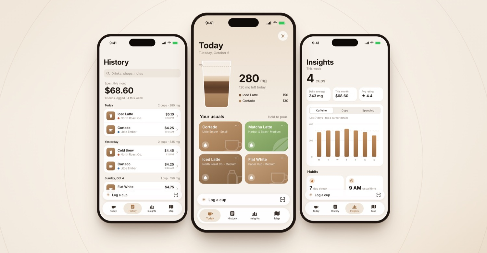

# Crema: Caffeine & Cup Log

A coffee journal for iPhone. Log a cup in seconds, then watch your day fill up like a glass.

[**Download on the App Store**](https://apps.apple.com/us/app/crema-caffeine-cup-log/id6819921757) · [Support](https://boyuchengz.github.io/crema/) · [Privacy policy](https://boyuchengz.github.io/crema/privacy.html)

## Features

- Today's caffeine drawn as a glass, with a layer per drink, how much is left before your daily limit, and roughly when you'll be ready for sleep.
- Your usuals: Crema learns regular orders, and holding one logs it.
- Scan a cup or receipt to fill in the drink, shop, size and price. Text recognition runs on the device.
- Insights for the last seven days: caffeine, cups, spending, streaks and your usual coffee time.
- A map of every café you've logged.
- Siri, Shortcuts and Action button support ("Log my usual", "Caffeine today").
- No account, no ads, no tracking. Your log stays on your iPhone and exports to CSV.

Requires iOS 26.

## About this repository

The app's source is private. This repository hosts the [support page](https://boyuchengz.github.io/crema/) and [privacy policy](https://boyuchengz.github.io/crema/privacy.html) served by GitHub Pages, and its [issue tracker](https://github.com/boyuchengz/crema/issues) is where bug reports and feature requests go.
